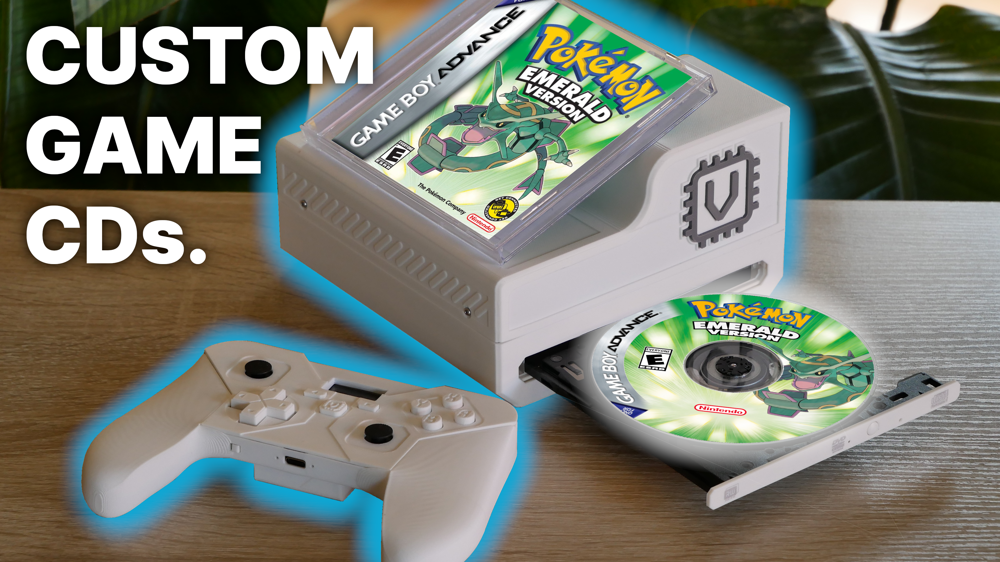

[See the build and design on YouTube!](https://www.youtube.com/watch?v=dW5HGrhBync)

# Nevolta CD Console

This project is a standalone **retro gaming station** based on the ZimaBoard 2 and the ESP32-S3. The console features:
- A fully custom BLE wireless controller
- Custom CD launching capability
- Custom PCBs
- 3D-printable design
- Fully open source!

"Nevolta" is the name for my personal console line-up. **(more are coming soon!)**

# Project Navigation

- The "Printables" folder contains labeled 3D printable files for the Console unit as well as the Controller.
- The "PCB" folder contains GERBER, CPL and BOM files for PCB fabrication.
- The "Firmware" folder contains code for the Controller, and custom CD-loading shell scripts for the console.

# Assembly

## Custom Controller
*Coming Soon*

## Console Unit
1. Melt in 4xM2 Heated Inserts into their respective holes in Console_Bottom.
2. Put in the CD Drive (Tailored for: Liteon 8x DVD USB 2.0 Slim)
3. Plug the Console_Crossbar into the holes in Console_Bottom.
4. Put in the Computer (ZimaBoard 2) and SSD (Intel 730 Series)
5. Put on the Console_Top cover and secure it with 4xM2 screws.

# Setup

## Controller (ESP32-S3)
- The ESP can be programmed when already soldered onto the board, since a data connection is present in the USB-C connector.
- Respective firmware (.INO) files are to be flashed via the [Arduino IDE](https://www.arduino.cc/en/software/)

## Console Unit (ZimaBoard 2)
- A standard Batocera build is used for the ZimaBoard, which you can access [here](https://batocera.org/download). Select the version for *"Desktop PC, Laptop, NUC and Intel-based Apple Computers".*
- Controller firmware uses the repo [ESP32-BLE-Gamepad](https://github.com/lemmingDev/ESP32-BLE-Gamepad) as a base for the wireless Bluetooth functionality.
- **Shell Script functionality documentation coming soon!**
